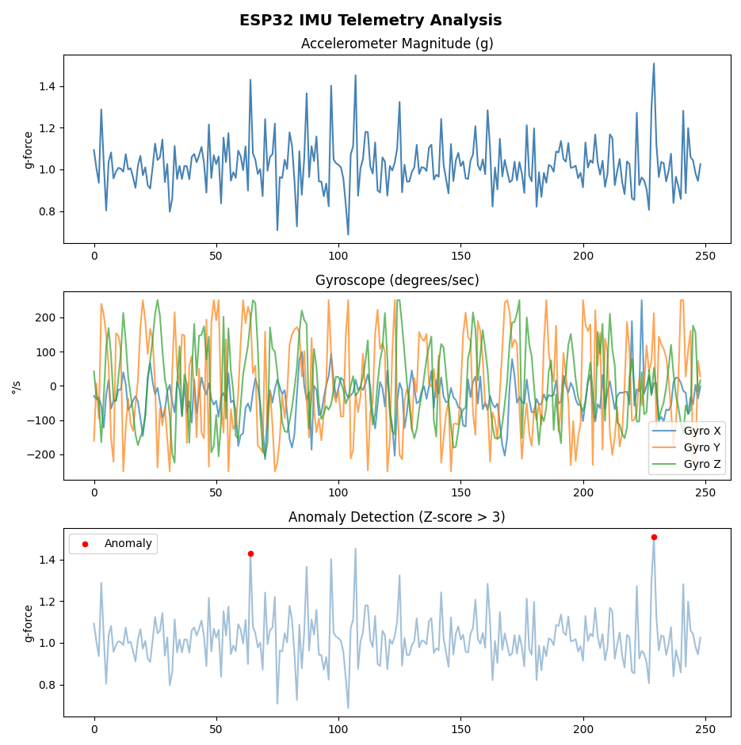
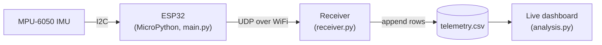

# ESP32 IMU Telemetry

A small end-to-end telemetry pipeline where an ESP32 reads an MPU-6050 IMU over I2C, streams the readings over WiFi via UDP to a Python receiver, and a live dashboard plots the data and flags anomalies with a rolling z-score.



## How it works



1. **Device (`main.py`, MicroPython on the ESP32).** Wakes the MPU-6050, reads the raw accelerometer and gyroscope registers over I2C, and converts them to physical units. It sends one comma-separated reading every 50 ms as a UDP packet.
2. **Receiver (`receiver.py`).** Listens on a UDP port, timestamps each packet with wall-clock time, and appends it to `telemetry.csv`.
3. **Dashboard (`analysis.py`).** Every second, reads the most recent 250 rows, computes the acceleration magnitude, and plots acceleration, gyroscope rates and detected anomalies.

## Anomaly detection

Readings are flagged when their acceleration magnitude is more than 3 standard deviations from the **rolling** mean of the previous 50 samples:

```
z = (magnitude − rolling_mean) / rolling_std, anomaly if |z| > 3
```

I used a rolling baseline rather than a fixed threshold so the detector adapts to the current behaviour of the device: a sudden jolt stands out, but a gradual change in orientation or drift doesn't trigger constant alerts.

## Design decisions

- **UDP rather than TCP.** For a live view, a fresh reading matters more than a guaranteed one: a dropped packet is simply replaced 50 ms later, and there is no connection setup or retransmission delay.
- **Reading only the tail of the CSV.** The dashboard seeks to the end of the file and parses just the last few hundred lines instead of loading the whole log with `pandas.read_csv`, so it stays fast as the log grows.

## Hardware

| Part | Notes |
|---|---|
| ESP32 development board | Running MicroPython |
| MPU-6050 IMU | I2C address `0x68` |

Wiring: **SCL → GPIO 22**, **SDA → GPIO 21**, plus 3.3 V and GND.

## Running it

1. **Configure:** copy `config.example.py` to `config.py` and fill in your WiFi details, your computer's local IP address and the port.
2. **Device:** flash MicroPython to the ESP32, then copy `main.py` and `config.py` onto the board (I used Thonny). Because the file is named `main.py`, it starts streaming on boot.
3. **Receiver:** on the computer, install the dependencies and start listening:
   ```bash
   pip install -r requirements.txt
   python receiver.py
   ```
4. **Dashboard:** in a second terminal:
   ```bash
   python analysis.py
   ```
   The anomaly plot needs about 50 readings (a few seconds) before the rolling statistics start.

## Limitations and next steps

- **UDP can drop or reorder packets.** That's acceptable for a live view, but not for data you need to keep. At larger scale I'd put a message queue, such as MQTT or Kafka, between the device and the processing, and store readings in a time-series database rather than a CSV.
- The dashboard re-reads the file on a timer; a production version would process the stream directly.
- Possible additions: an FFT view of the accelerometer signal for vibration analysis, sensor calibration, and sequence numbers to detect lost packets.
